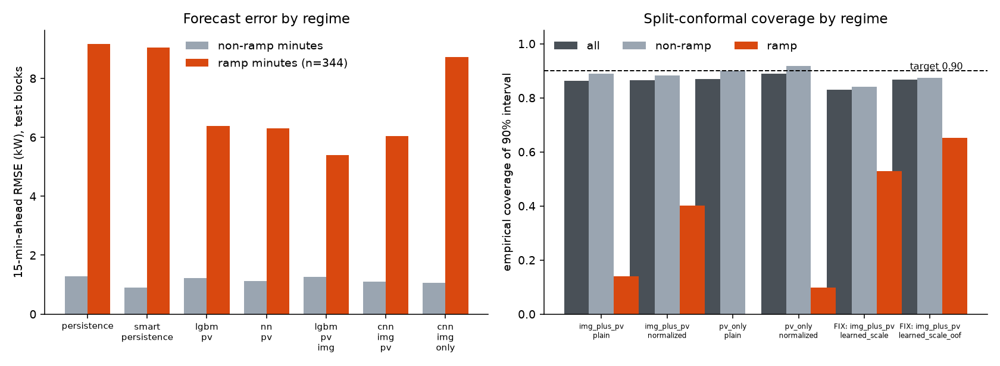
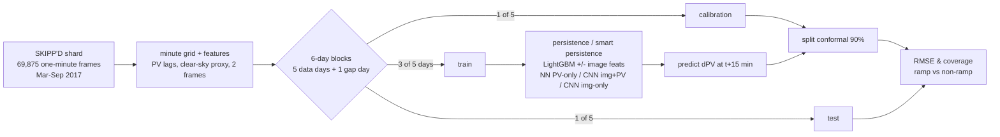

# SkyRamp — do sky images help 15-minute PV nowcasts at ramp events, and can you trust the intervals?

Honest evaluation harness on the public **SKIPP'D** dataset (sky images + 1-minute PV power, Stanford).
It compares PV-only forecasters with image+PV forecasters **separately on ramp vs non-ramp minutes**, wraps the
best one in split-conformal intervals, and reports coverage **conditional on ramps**.

**Verdict: PARTIAL.** Images help at ramps (formal claim A passes, but the margin is fragile — see below).
Conformal 90% intervals do **not** hold at ramps: 14% ramp coverage (constant width), 65% after two fix attempts.



| Claim (pre-declared in `skyramp/config.py`) | Result | Verdict |
|---|---|---|
| A. image+PV cuts ramp-minute RMSE ≥5% vs best PV-only (CI lower bound > 0) | 33.3% lower RMSE vs smart persistence (95% CI 27–44%), **but only 4.4% vs the NN PV-only model** | passes by the pre-declared rule; fragile |
| B. 90% conformal coverage in [0.87, 0.93] and ≥0.80 on ramps | 0.864 overall, **0.14 on ramps**; best fix 0.867 / 0.65 | **REFUTED** |

Details, every run and both fix attempts: [EVAL-FINDINGS.md](EVAL-FINDINGS.md). Raw numbers: [eval_results.json](eval_results.json).

## 30-second demo (no download, no training)

```bash
pip install -r requirements.txt
python -m skyramp.demo     # recomputes the eval from committed predictions, prints the table
python -m skyramp.plot     # regenerates results/results.png from eval_results.json
```

## Full reproduction (~25 min on a 12-core CPU, ~450 MB download)

```bash
python -m skyramp.extract          # streams one contiguous SKIPP'D train shard -> cache/ (32x32 frames)
python -m skyramp.train            # fits all models (CNN ~9 min each), writes results/predictions.csv.gz
python -m skyramp.eval first_run   # EVAL GATE; appends to eval_results.json
python -m skyramp.eval_fix1 && python -m skyramp.eval_fix2   # the two conformal fix attempts
```

## How it works



* **Target:** `pv(t+15min) − pv(t)`. **Ramp** = `|Δ| ≥ 5 kW` (fixed before any result; 344 of 10,229 test minutes).
* **No temporal leakage:** whole days are assigned to train/calib/test, a discarded gap day separates blocks.
* **Model choice** inside each family (PV-only vs image+PV) is made on the calibration block only.

## What was cut / not done

* One time-ordered shard (Mar–Sep 2017), 32×32 downsampled frames — not the full 2.3 GB, not 64×64.
* Cross-site transfer (SKIPP'D → NREL) **dropped**: NREL has irradiance, not plant PV, so it is not comparable.
* ERA5 covariates skipped (needs a CDS key). No hyperparameter search. 15 calibration days / 15 test days only.
* I did not read the 2026 LLM-fusion SKIPP'D preprint noted in validation, so nothing here claims novelty.

## Reference

* **Dataset / benchmark:** Nie, Y., Li, X., Scott, A., Sun, Y., Venugopal, V., Brandt, A. *SKIPP'D: a SKy Images and
  Photovoltaic Power Generation Dataset for short-term solar forecasting.* Solar Energy 2023, arXiv:2207.00913
  (data used via the HF mirror `winkqw/SKIPPD`, CC-BY-4.0).
* **Conformal methods:** Vovk et al. split conformal prediction; locally-weighted variant after Lei et al. 2018,
  *Distribution-free predictive inference for regression*, arXiv:1604.04173.
* **Reproduced:** the sky-image + PV-history 15-min forecasting setup on SKIPP'D (own small CNN, not the paper's SUNSET net).
  **Added:** chronological day-block split with gaps, ramp-conditional RMSE, conformal intervals and ramp-conditional
  coverage. **Delta/contribution:** the negative result — marginal conformal coverage is nearly right while coverage on
  ramp minutes collapses (0.14), and learned local scales recover only part of it (0.65).
